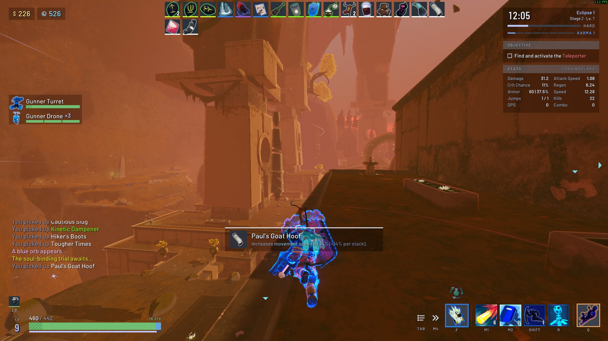
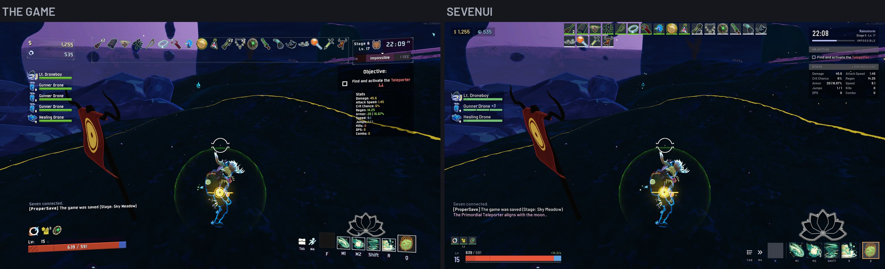
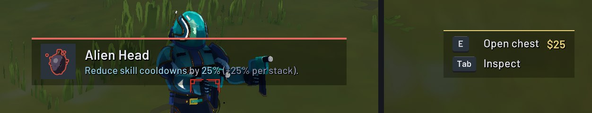
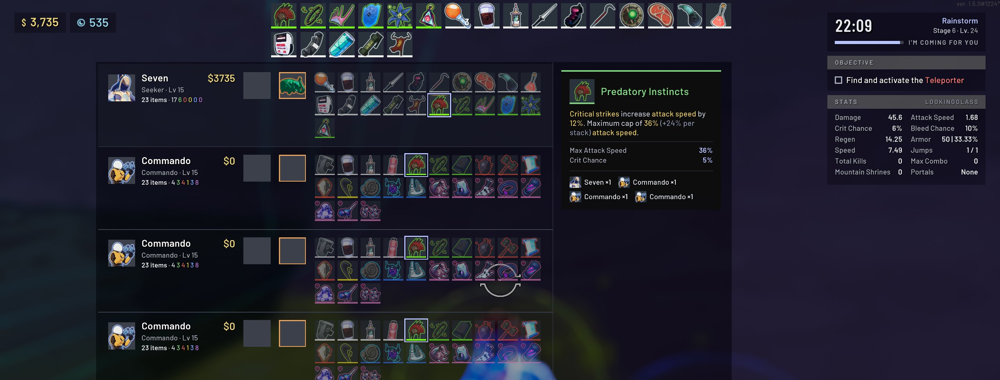
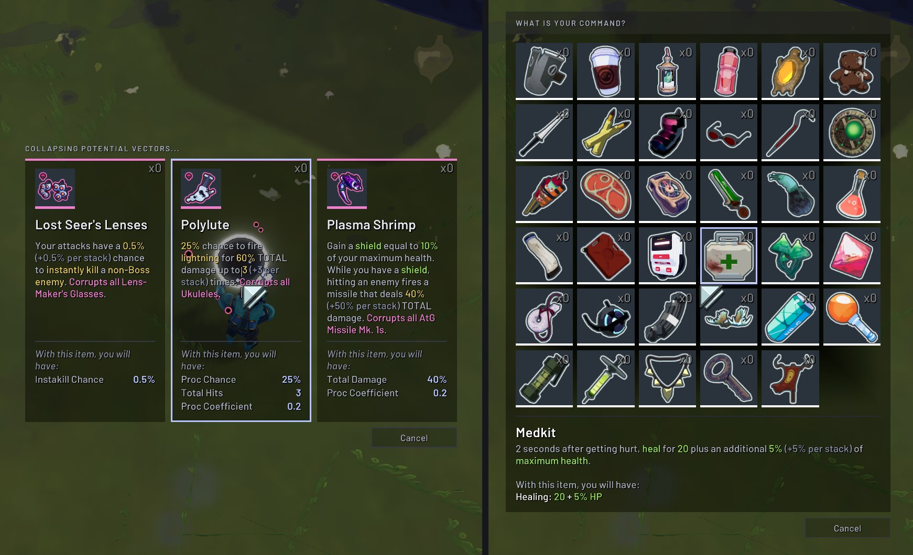

# SevenUI

A flat restyle of Risk of Rain 2's HUD: Barlow text, flat translucent panels and bars, and a matching scoreboard, tooltips, item pickers and pause menu. The game's layout stays the same, so other HUD mods keep working.

## What it changes

- **Text:** Barlow throughout the HUD, Barlow Condensed for timers, levels and cooldowns, and JetBrains Mono for damage numbers.
- **Panels and bars:** flat and translucent, with the HUD facing the screen squarely and sitting closer to its edges.
- **Health:** the barrier as a gold strip along the top, curses and one-shot protection as stripes, and the numbers as text.
- **Run info:** the timer, difficulty or Eclipse level, stage, Karma and artifacts in one panel.
- **Items, buffs and skills:** dark slots with tier colors, and a cooldown cover that shrinks as a skill recharges.
- **Prompts and notifications:** keycaps, with a strip in the color of the cost or the item's tier.
- **Ally cards:** allies of one kind share a card, "Gunner Drone ×8", with a bar segment for each, so a crowd of drones stays clear of the chat.
- **Scoreboard:** a row or a tab per player, with item counts per tier and the items at full size sorted by tier. The item you point at is described in a panel docked on the board, with who else holds it.
- **Tooltips, item pickers and pause menu:** restyled to match.

## Compatibility

- **Multiplayer:** client-side. It only changes your own HUD, so it works when you join a host who doesn't have it.
- **[LookingGlass](https://thunderstore.io/package/DropPod/LookingGlass/):** its stats panel, buff timers, item stats and full descriptions take on the same look.
- **Languages:** Barlow has Latin letters only. Languages the game draws in Noto Sans, such as Russian, Chinese, Japanese and Korean, keep the game's font.

## Configuration

Edit `BepInEx/config/sevenstack.SevenUI.cfg`, or use [Risk Of Options](https://thunderstore.io/package/Rune580/Risk_Of_Options/) (optional) in game.

| Setting | Default | Description |
|---|---|---|
| `BarlowFont` | true | Draw HUD text in Barlow. |
| `MonospaceDamageNumbers` | true | Draw damage numbers in JetBrains Mono. |
| `FlatPanels` | true | The flat look: panels, bars, slots, scoreboard, tooltips, pickers and the pause menu. Off brings back the game's look. |
| `TightMargins` | true | Keep the HUD near the screen's edges, as on SevenUI's design. Only with `FlatPanels` on. |
| `ScoreboardBesideRunInfo` | true | Place the scoreboard near the top of the screen, beside the run info. Only with `FlatPanels` on. |
| `ScoreboardLayout` | Rows | Rows: a row per player, their items after their equipment. Tabs: one player at a time, picked from tabs along the top. Only with `FlatPanels` on. |
| `DebugLogging` | false | Log extra detail, and enable the dump key. |
| `DebugAlwaysShow` | false | Show the mod's visuals even when they wouldn't normally appear, for testing. |
| `DumpKey` | F8 | With `DebugLogging` on, log each HUD's fonts and what the mod restyled. |

Every change, part by part, is described in [SevenUI in detail](https://github.com/jacob5567/SevenUI/blob/main/docs/DETAILS.md).

## Building

Requires the .NET 8 SDK, a local Risk of Rain 2 install, and Risk Of Options in the r2modman profile. `dotnet build -c Release` builds the plugin and copies it into the r2modman Default profile (`-p:CopyToProfile=false` skips the copy), and `./build.sh` also writes the Thunderstore zip to `dist/`. Paths, overrides and the in-game tests are covered in [SevenUI in detail](https://github.com/jacob5567/SevenUI/blob/main/docs/DETAILS.md#building).

The version lives in `thunderstore/manifest.json`. To release, bump it, run `./build.sh`, and publish a GitHub release tagged `v<version>` with the zip attached. The publish workflow then uploads that zip to Thunderstore.

## License

[GPL-3.0](https://github.com/jacob5567/SevenUI/blob/main/LICENSE). The Barlow fonts are by The Barlow Project Authors and the damage numbers are drawn from JetBrains Mono by The JetBrains Mono Project Authors, both under the SIL Open Font License 1.1 ([Barlow](https://github.com/jacob5567/SevenUI/blob/main/fonts/OFL.txt), [JetBrains Mono](https://github.com/jacob5567/SevenUI/blob/main/fonts/OFL-JetBrainsMono.txt)).
